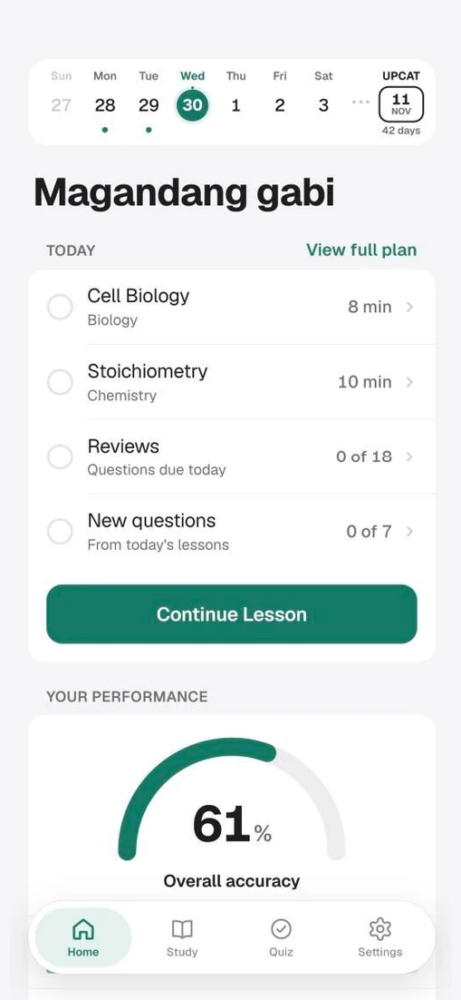
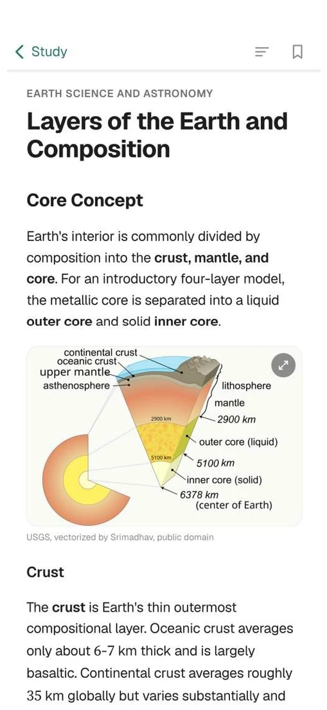
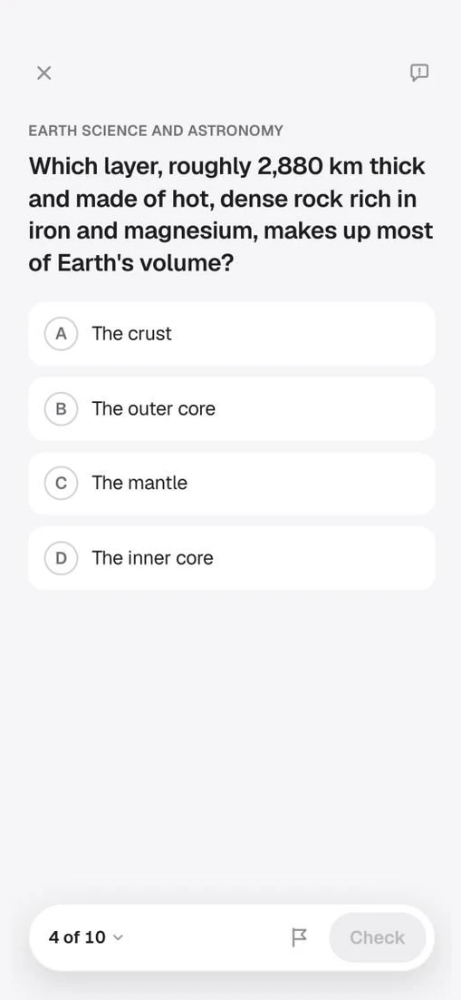
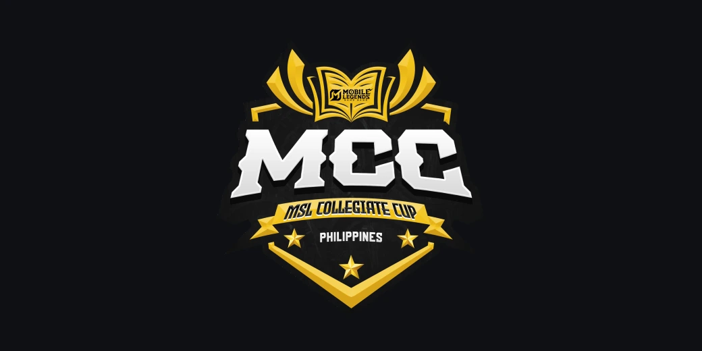

# Aerol Balayon

[aedwon.site](https://www.aedwon.site) · [LinkedIn](https://linkedin.com/in/aedwon) · [Discord](https://discord.com/users/aedwon) · [Email](mailto:aerol.balayon@gmail.com)

I build apps, bots and web tools, mostly for events, communities and exam prep. This repository is the source of my portfolio. The full list of work is on [aedwon.site](https://www.aedwon.site).

## Selected work

### [Pantas](https://pantas.app)

Pre-launch Android reviewer for Philippine civil service and university entrance preparation. Study state is stored locally and encrypted, and FSRS-6 schedules reviews on the device.

<p align="center">
  
  
  
</p>

`Flutter` `Dart` `Firebase` `Drift` `RevenueCat`

---

<table>
  <tr>
    <td width="50%" valign="top">
      <a href="https://github.com/Aedwon/marwie-server-bot"></a><br /><br />
      <b><a href="https://github.com/Aedwon/marwie-server-bot">Marwie Community Bot</a></b><br /><br />
      Discord bot for the Marwie AI App Builders server. It handles moderation, tickets, temporary voice rooms and quizzes, and settings can also be changed from a web control panel.<br /><br />
      <code>Python</code> <code>discord.py</code> <code>SQLite</code> <code>PostgreSQL</code>
    </td>
    <td width="50%" valign="top">
      <a href="https://github.com/Aedwon/Discord-Bot"></a><br /><br />
      <b><a href="https://github.com/Aedwon/Discord-Bot">MSL Network Bot</a></b><br /><br />
      Single-server Discord bot for an MLBB community. It ties account verification to XP, Event Points, events, quests, moderation and reporting.<br /><br />
      <code>Python</code> <code>discord.py</code> <code>MySQL</code>
    </td>
  </tr>
  <tr>
    <td width="50%" valign="top">
      <a href="https://www.aedwon.site/work/cup"></a><br /><br />
      <b><a href="https://www.aedwon.site/work/cup">MSL Collegiate Cup Bot</a></b><br /><br />
      Ran match operations for the Collegiate Cup. Teams log results, the other side acknowledges within five minutes or files a dispute, and live matches survive a restart.<br /><br />
      <code>Python</code> <code>discord.py</code>
    </td>
    <td width="50%" valign="top">
      <a href="https://github.com/Aedwon/kiosk-survey"></a><br /><br />
      <b><a href="https://github.com/Aedwon/kiosk-survey">Kiosk Survey</a></b><br /><br />
      Offline Android TV survey app. It ran for eight continuous hours at a live event with no internet, and the answers left the TV on a flash drive.<br /><br />
      <code>Flutter</code> <code>Dart</code> <code>Hive</code>
    </td>
  </tr>
</table>

The rest is on [aedwon.site](https://www.aedwon.site).

## Open source

I contribute to [Microsoft Aspire](https://github.com/microsoft/aspire), [OpenSRE](https://github.com/Tracer-Cloud/opensre), [DockRoute](https://www.dockroute.dev/) and [BetterGov PH](https://bettergov.ph).

## This repository

The site is a room. Projects hang on a **Wall**, the **Index** lists them, each project has its own page, and the About section is a shelf of books. The phone layout is designed separately at 390 by 844 instead of being a squeezed desktop page.

`Next.js 16` `React 19` `TypeScript` `Vitest`

- **Styling.** The current design uses role-based CSS tokens for dark and light modes (`lib/design-v3/tokens.css`). The older `/projects` and `/blogs` routes still use Tailwind CSS.
- **Content.** Every project is one JSON file in `content/projects`, and the About books are in `content/site`. No project copy lives in TypeScript.
- **Local studio.** Under `npm run dev`, press Edit on any project page to change text, pictures and links in the browser. It saves to the JSON files and can commit and push them. It only runs on localhost. See [`docs/studio.md`](docs/studio.md).
- **Animated diagrams.** Some bot and tooling projects carry a small SVG flow diagram, driven by a spec in `lib/design-v3/data/flows.ts`. It plays on hover on the wall and loops on the project page, and it stays still when reduced motion is requested.

<details>
<summary><b>Agent-facing surface</b></summary>

The same content has a machine-readable form. [`/llms.txt`](https://www.aedwon.site/llms.txt) describes the portfolio and its canonical sources, and pages return Markdown when requested with `Accept: text/markdown`. [`/sitemap.xml`](https://www.aedwon.site/sitemap.xml) and [`/robots.txt`](https://www.aedwon.site/robots.txt) cover the public index and crawler guidance.

CI runs the tests, lint and the production build. It then starts the built app and checks status codes, content negotiation, metadata, 404 behavior and the machine-readable endpoints with real HTTP requests.

</details>

## Run it locally

Node 24 is required.

```bash
git clone https://github.com/Aedwon/aedwon.git
cd aedwon
npm install
npm run dev        # http://127.0.0.1:3000, local studio on
npm test
npm run lint
npm run build
```

`npm run dev:lan` serves the site on your network for testing on a real phone. The studio is off in that mode.

## Where things are

| Path | What it holds |
|---|---|
| `app/(v3)` | The current routes: wall, index, work, writing, about, contact |
| `app/(v2)` | The older `/projects`, `/blogs` and `/privacy` routes |
| `components/design-v3` | The wall, index, project pages, About books and phone layout |
| `content` | Project and About copy as JSON |
| `lib/design-v3` | Tokens, theme and the data loaders and specs |
| `lib/studio` | The local studio's server side |
| `v3-design` | The approved design handoff: spec, reference prototype, recordings |
| `docs` | Studio guide, blog and tone rules, the living copy file |

## Writing rules

Anything written for the site follows [`AGENTS.md`](AGENTS.md). Blog posts also follow [`docs/blog-writing.md`](docs/blog-writing.md).
